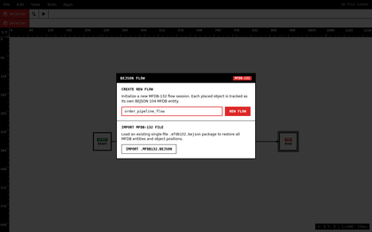
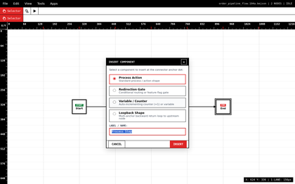
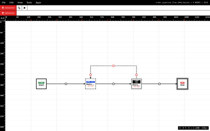
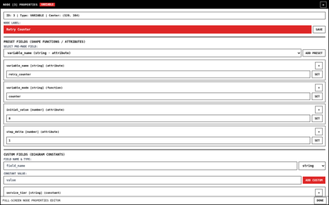
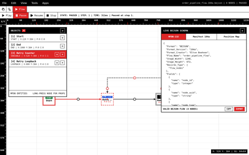
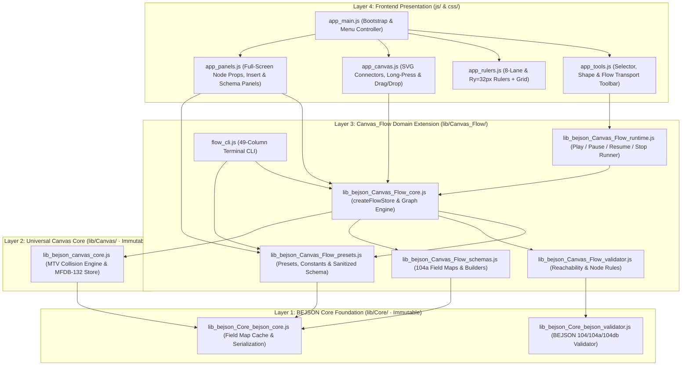

# BEJSON Flow

[](LICENSE)
[](index.html)
[-DE2626.svg)](bejson_project.json)

**BEJSON Flow** is a spatial directed-graph workflow editor, simulation engine, and command-line runtime built on top of the Universal Canvas Core Framework (`lib_bejson_canvas_core.js`) and the `Canvas_Flow` extension family. It combines deterministic 8-lane horizontal quantization and $R_y = 32\text{px}$ vertical rhythm with center-first `(cx, cy)` node addressing, midpoint and multi-anchor backward loopback connectors, shape-specific functional preset fields, constant custom fields, conditional termination gates, and interactive step-by-step flow execution.

---

## Table of Contents

- [1. Overview & Key Capabilities](#1-overview--key-capabilities)
- [2. Prerequisites & Setup](#2-prerequisites--setup)
- [3. Installation & Quick Start](#3-installation--quick-start)
- [4. Visual Interface Tour & Core Workflows](#4-visual-interface-tour--core-workflows)
  - [4.1 Startup File Gate & Session Initialization](#41-startup-file-gate--session-initialization)
  - [4.2 Anchor-Driven Component Insertion](#42-anchor-driven-component-insertion)
  - [4.3 Multi-Anchor Loopback Routing & Spatial Canvas](#43-multi-anchor-loopback-routing--spatial-canvas)
  - [4.4 Long-Press Full-Screen Node Properties Editor](#44-long-press-full-screen-node-properties-editor)
  - [4.5 Interactive Flow Transport & Live BEJSON Schema Inspection](#45-interactive-flow-transport--live-bejson-schema-inspection)
- [5. System Architecture & Separation of Concerns](#5-system-architecture--separation-of-concerns)
  - [5.1 Layered Module Topology](#51-layered-module-topology)
  - [5.2 Directory Tree](#52-directory-tree)
- [6. Spatial Coordinate Mathematics & Layering Laws](#6-spatial-coordinate-mathematics--layering-laws)
  - [6.1 Center-First Coordinate Addressing](#61-center-first-coordinate-addressing)
  - [6.2 Connector Layering & Directional Arrowhead Geometry](#62-connector-layering--directional-arrowhead-geometry)
  - [6.3 Midpoint Anchor Dots & 3-Anchor Backward Loopback Geometry](#63-midpoint-anchor-dots--3-anchor-backward-loopback-geometry)
  - [6.4 Minimum Translation Vector (MTV) Non-Overlap Resolution](#64-minimum-translation-vector-mtv-non-overlap-resolution)
- [7. Flow Node Taxonomy & Preset Catalogs](#7-flow-node-taxonomy--preset-catalogs)
  - [7.1 Node Types & Execution Semantics](#71-node-types--execution-semantics)
  - [7.2 Shape-Specific Preset Fields vs. Custom Constant Fields](#72-shape-specific-preset-fields-vs-custom-constant-fields)
  - [7.3 End Node Stop Conditions](#73-end-node-stop-conditions)
- [8. Technical Specifications & BEJSON 104a Schemas](#8-technical-specifications--bejson-104a-schemas)
  - [8.1 Flow Document Schema (`flow_nodes` & `flow_connectors`)](#81-flow-document-schema-flow_nodes--flow_connectors)
  - [8.2 Sanitized Node Options Schema (`flow_node_options_schema`)](#82-sanitized-node-options-schema-flow_node_options_schema)
- [9. JavaScript Programmatic API Reference](#9-javascript-programmatic-api-reference)
  - [9.1 Flow Store API (`createFlowStore`)](#91-flow-store-api-createflowstore)
  - [9.2 Interactive Flow Runtime API (`createFlowRuntime`)](#92-interactive-flow-runtime-api-createflowruntime)
  - [9.3 Flow Presets & Sanitized Schema API (`FlowPresets`)](#93-flow-presets--sanitized-schema-api-flowpresets)
- [10. Command-Line Interface Reference (`flow_cli.js`)](#10-command-line-interface-reference-flow_clijs)
  - [10.1 Command Matrix](#101-command-matrix)
  - [10.2 End-to-End CLI Pipeline Examples](#102-end-to-end-cli-pipeline-examples)
- [11. Testing, Hardening & Verification Suite](#11-testing-hardening--verification-suite)
- [12. License & Attribution](#12-license--attribution)

---

## 1. Overview & Key Capabilities

BEJSON Flow models every flowchart diagram as a validated tabular BEJSON 104a and `MFDB-132` multi-entity database while presenting an interactive spatial canvas in the browser and a 49-column tool in the terminal.

Key technical capabilities include:

1. **Mandatory Boundary Invariants (`Start` & `End` Nodes):** Every flow session initializes with connected `Start` and `End` boundary nodes that cannot be accidentally deleted, guaranteeing a well-defined entry origin and termination sink.
2. **Anchor-Split Node Insertion:** Every connector line renders an interactive midpoint anchor dot (`radius = 6px`). Clicking any anchor dot splits the connector in-place and inserts a new flow component (`shape`, `redirect`, `variable`, or `loopback`) while automatically resolving spatial collisions via the underlying Minimum Translation Vector (MTV) engine.
3. **Multi-Anchor Backward Loopback Routing (`loopback` Node):** Loopback nodes generate an orthogonal 3-segment U-loop return path offset above or below the primary flow axis. Each backward loop exposes **3 interactive anchor dots** (`Loop Exit Anchor`, `Loop Return Anchor`, and `Loop Re-entry Anchor`) so intermediate process, counter, or gate nodes can be inserted directly inside the backward loop.
4. **Redirection Gate Side Anchor Stubs (`redirect` Node):** Redirection decision gates expose a horizontal side stub (`ALT` branch anchor, $48\text{px}$ offset) with an interactive red side anchor dot. Clicking this side anchor launches the insertion palette to attach alternate branch nodes without dead-end routing.
5. **Shape-Specific Preset Fields vs. Custom Constant Fields:**
   - **Preset Fields:** Functional attributes and operations tailored to each shape type (`start`, `end`, `shape`, `redirect`, `variable`, `loopback`) that execute during flow traversal and serialize into the diagram's BEJSON record. The preset selection combo defaults to a neutral null state (`-- Select Pre-Made Field --`) with empty submission validation and visual confirmation (`Added ✓` feedback).
   - **Custom Fields:** User-defined typed constant metadata fields (`string`, `number`, `integer`, `boolean`) attached to a node's diagram record without side-effects during runtime execution.
6. **Configurable End Node Stop Conditions:** The `End` node supports immediate termination (`always`), elapsed duration thresholds (`time_running >= max_time_ms`), exact variable equality (`variable_equals`), and numeric threshold gates (`variable_gte`).
7. **Long-Press Full-Screen High-Contrast Node Properties Overlay:** Holding pointer contact on any canvas node for `450ms` (with a `6px` drag-cancellation threshold) opens a full-screen (`100vw x 100vh`) root-level overlay with solid `#000000` background and high-contrast ergonomics: white inputs and buttons with black typography that invert to `#DE2626` red backgrounds with `#FFFFFF` white typography when focused or active, dismissible via `Escape` or the close control.
8. **Sanitized Node Options Schema Export & Import:** Node option configurations can be exported and imported as standalone BEJSON 104a schemas (`flow_node_options_schema`) stripped of all personal identifiers, UUIDs, session specifics, spatial coordinates, and instance values.
9. **Interactive Main Toolbar Transport (`Play`, `Pause`, `Resume`, `Stop`):** Selecting `Flow` in the primary toolbar exposes asynchronous step-by-step execution controls with live canvas node/connector highlighting and real-time step/elapsed-millisecond telemetry.


*_Figure 1: BEJSON Flow Startup File Gate enforcing session initialization or MFDB-132 package import._*

---

## 2. Prerequisites & Setup

BEJSON Flow operates with zero external npm runtime dependencies in both browser and Node.js environments.

- **Browser Runtime:** Any modern HTML5/ES6 browser (Chromium, Firefox, WebKit) supporting Canvas 2D, inline SVG, and CSS Grid.
- **Command-Line & Test Runtime:** Node.js `>= 18.0.0` (tested on Node.js v26+).
- **Optional Local Static Server:** Python `>= 3.10` (`python3 -m http.server`) or any static HTTP file server for browser previewing.

To clone and configure the repository locally:

```bash
git clone https://github.com/boehnenelton/BEJSON_Flow.git
cd BEJSON_Flow
```

If integrating with local environment variables, set `PROJECT_ROOT` to your checkout directory:

```bash
export PROJECT_ROOT="$(pwd)"
```

---

## 3. Installation & Quick Start

### 3.1 Launching the Browser Application

Serve the repository root over any local HTTP server and open `index.html`:

```bash
python3 -m http.server 8080 --bind 127.0.0.1
```

Navigate to `http://127.0.0.1:8080/index.html`. At the Startup File Gate:
1. Enter a flow database name (e.g., `order_pipeline_flow`) and click **New Flow**, or
2. Click **Import .mfdb132.bejson** to restore a saved flow package from disk.

### 3.2 Running the Terminal Flow CLI (`flow_cli.js`)

Create, populate, validate, and simulate a complete looping flow directly from the terminal:

```bash
# 1. Initialize a new BEJSON 104a flow file
node lib/Canvas_Flow/flow_cli.js init ./my_flow.104a.bejson --name order_retry_flow

# 2. Insert a Variable Counter (+1) on connector 1
node lib/Canvas_Flow/flow_cli.js add-node ./my_flow.104a.bejson \
  --connector 1 --type variable --var attempt_count --mode counter --label "Attempt Counter"

# 3. Insert a Loopback node after Attempt Counter looping back to Node 3 for 2 iterations
node lib/Canvas_Flow/flow_cli.js add-node ./my_flow.104a.bejson \
  --type loopback --target 3 --loops 2 --label "Retry Loop"

# 4. Configure End node stop condition to require attempt_count == 3
node lib/Canvas_Flow/flow_cli.js set-stop ./my_flow.104a.bejson \
  --condition variable_equals --var attempt_count --target 3

# 5. Validate BEJSON 104a structure and directed graph reachability
node lib/Canvas_Flow/flow_cli.js validate ./my_flow.104a.bejson

# 6. Execute flow traversal simulation
node lib/Canvas_Flow/flow_cli.js simulate ./my_flow.104a.bejson
```

---

## 4. Visual Interface Tour & Core Workflows

### 4.1 Startup File Gate & Session Initialization

Upon launch, BEJSON Flow presents a modal Startup File Gate (`#be-startup-gate`). This guarantees that every active canvas session is backed by a named BEJSON 104a / `MFDB-132` store before any nodes or connectors are mutated.

### 4.2 Anchor-Driven Component Insertion

Every connector line displays an interactive circular anchor dot at its midpoint (or along its backward return segments for loopback connectors). Clicking an anchor dot opens the **Insert Component** overlay panel (`#be-panel-insert-node`), allowing you to choose between:

- **Process Action (`shape`):** Standard operational step with configurable `action_fn` (`transform`, `set_var`, `append_tag`, `delay_ms`, `noop`).
- **Redirection Gate (`redirect`):** Conditional branch router evaluating a feature flag or context variable (`is_true`, `equals`, `gt`, `gte`, `lt`).
- **Variable / Counter (`variable`):** Context state mutator supporting `counter` (`+1` auto-increment), `declare` (initial assignment), or `accumulate` (`+step_delta`).
- **Loopback Shape (`loopback`):** Backward return router targeting any upstream node for $N$ iterations or until an exit variable matches a target value.


*_Figure 2: Insert Component overlay modal triggered by clicking a connector midpoint anchor dot._*

---

### 4.3 Multi-Anchor Loopback Routing & Spatial Canvas

When a `loopback` node is inserted, `Canvas_Flow` constructs both a forward exit connector and a dashed 3-segment orthogonal backward return path offset vertically by `loop_offset_y` (default `-96px`).

The backward return loop provides **3 distinct anchor points**:
1. **Anchor 0 (`loop_exit`):** Midpoint of the vertical rise segment exiting the loopback node.
2. **Anchor 1 (`loop_return`):** Midpoint of the horizontal backward return span.
3. **Anchor 2 (`loop_reentry`):** Midpoint of the vertical descent segment re-entering the upstream target node.

Clicking any of these 3 loopback anchor dots splits the return path and inserts intermediate nodes directly inside the backward loop.

### 4.3.1 Redirection Gate Side Anchor Stubs & Alternate Branches

Redirection gates (`redirect` shape nodes) evaluate conditional routing logic. In addition to the primary pass-through connector along the main horizontal spine, each redirection node renders a dedicated **Side Anchor Stub**:
- **Geometry:** A dashed horizontal branch connector line protruding $48\text{px}$ from the node center (`pos_cx + 48px`, `pos_cy`) terminated by a labeled `ALT` branch badge.
- **Interactive Side Anchor Dot:** An interactive red anchor dot (`radius = 6px`, `.be-anchor-dot--redirect-branch`) positioned at the end of the stub.
- **Branch Node Insertion:** Clicking the redirection side anchor launches the component insertion overlay configured for alternate branch attachments (`openInsertNodePanelForBranch`). Selecting and submitting any node component automatically attaches it along the alternate path, preventing dead-end branch paths and maintaining structural flow integrity.


*_Figure 3: 8-Lane / Ry=32px Flow Workspace showing Start, Retry Counter, Multi-Anchor Loopback (with 3 red-ringed return anchor dots), and End nodes._*

---

### 4.4 Long-Press Full-Screen Node Properties Overlay

Dragging a node moves it immediately across the stage with real-time X/Y ruler trackers and MTV collision avoidance. Holding pointer contact on a node for **`450ms`** without moving more than `6px` triggers the **Full-Screen Node Properties Overlay** (`#be-panel-node-props`).

Situated at the root `<body>` DOM level to avoid parent container z-index clipping, the overlay occupies the full viewport (`100vw x 100vh`) against a solid `#000000` deep black backdrop and enforces strict high-contrast ergonomics:
- **Resting High Contrast:** All input boxes, dropdown selects, textareas, and buttons render with a `#FFFFFF` white background, `#000000` black text, and crisp `1px` borders for maximum legibility.
- **Vivid Red Focus State:** Any focused, selected, or active input box or button immediately switches to a `#DE2626` vivid red background with `#FFFFFF` pure white typography.
- **Pre-Made Field Combo Null State:** The shape-specific preset field dropdown initializes with a neutral placeholder option (`-- Select Pre-Made Field --`, value `""`). Attempting to add without choosing a preset alerts the user with an actionable inline warning.
- **Visual Button Confirmation:** Clicking **Add Pre-Made Field** switches the button text to **`Added ✓`** with an inline green confirmation banner (`Preset field added to node`), automatically reverting after `1500ms`.
- **Keyboard & Touch Dismissal:** The overlay can be dismissed at any time by pressing `Escape` or clicking the top-right close button (`&times;`), preserving all modified node attributes.
- **Options Schema Transfer:** From this screen you can also configure **End Node Stop Conditions**, attach typed **Custom Constant Fields**, and export or import **Sanitized Node Options Schemas**.


*_Figure 4: Full-screen high-contrast Node Properties Overlay showing a focused red input box with white text, shape preset fields, custom constant fields, and the sanitized Node Options Schema panel._*

---

### 4.5 Interactive Flow Transport & Live BEJSON Schema Inspection

Selecting **Flow** in the Row 1 main toolbar populates Row 2 with transport controls (**Play**, **Pause**, **Resume**, **Stop**) and a live status strip (`STATE: RUNNING / PAUSED / COMPLETED | STEP | TIME`). During execution, the active node and traversed connector highlight in `#DE2626` red on the canvas while the **View Objects** and **Live BEJSON Schema** panels update in real time.


*_Figure 5: Main toolbar Flow Transport controls (Play, Pause, Resume, Stop) running alongside the Objects inspector and Live BEJSON 104a Schema viewer._*

---

## 5. System Architecture & Separation of Concerns

### 5.1 Layered Module Topology

BEJSON Flow enforces strict modular isolation across four architectural layers. The foundational serialization and spatial libraries (`lib/Core/` and `lib/Canvas/`) are immutable baselines; all flow semantics live in `lib/Canvas_Flow/` and `js/`.



### 5.2 Directory Tree

```text
BEJSON_Flow/
├── AGENTS.md                        # Standing architectural rules & implementation plan
├── CHANGELOG.md                     # Versioned package release notes
├── LICENSE                          # PolyForm Noncommercial License 1.0.0
├── README.md                        # Repository documentation
├── bejson_project.json              # BEJSON 104a project manifest (PKG 110)
├── index.html                       # Application shell & overlay panel markup
├── css/
│   ├── behtml_base.css              # Tri-Color spatial shell, toolbars, rulers & stage
│   └── behtml_panels.css            # Full-screen Node Properties editor & modals
├── images/
│   ├── 01_startup_gate.png          # 420p Startup File Gate capture
│   ├── 02_insert_component_modal.png# 420p Insert Component modal capture
│   ├── 03_flow_canvas_loopback.png  # 420p Multi-anchor Loopback workspace capture
│   ├── 04_fullscreen_node_properties.png # 420p Full-screen high-contrast properties editor
│   └── 05_flow_transport_and_schema.png  # 420p Flow transport controls & live schema viewer
├── js/
│   ├── app_canvas.js                # SVG connector/anchor renderer & 450ms long-press handler
│   ├── app_main.js                  # Application lifecycle & keyboard shortcut wiring
│   ├── app_panels.js                # Node Properties editor, schema viewer & file I/O
│   ├── app_rulers.js                # 8-lane horizontal & Ry=32px vertical ruler renderer
│   └── app_tools.js                 # Dual horizontally-scrollable toolbars & Flow transport
└── lib/
    ├── Core/                        # Immutable BEJSON Core & MFDB validator modules
    ├── Canvas/                      # Immutable Universal Canvas Core & MTV collision engine
    └── Canvas_Flow/                 # Flow domain extension libraries
        ├── index.js                 # CommonJS unified exports facade
        ├── flow_cli.js              # 49-column terminal CLI for BEJSON Flow files
        ├── lib_bejson_Canvas_Flow_core.js      # Flow store, graph mutators & simulation
        ├── lib_bejson_Canvas_Flow_errors.js    # Error registry (codes 650-660)
        ├── lib_bejson_Canvas_Flow_presets.js   # Shape presets, custom fields & stop evaluator
        ├── lib_bejson_Canvas_Flow_runtime.js   # Async Play/Pause/Resume/Stop controller
        ├── lib_bejson_Canvas_Flow_schemas.js   # Authoritative 104a schemas & field maps
        ├── lib_bejson_Canvas_Flow_templates.js # Starter flow topology builders
        ├── lib_bejson_Canvas_Flow_validator.js # Directed graph & node validator
        └── tests/
            └── test_canvas_flow.js  # 15-section unit & hostile boundary test suite
```

---

## 6. Spatial Coordinate Mathematics & Layering Laws

### 6.1 Center-First Coordinate Addressing

Every node in BEJSON Flow is addressed exclusively by its geometric center coordinate $(c_x, c_y)$. Top-left bounding coordinates $(x, y)$ are derived dynamically at render time:

$$x = c_x - \frac{\text{size}}{2}, \qquad y = c_y - \frac{\text{size}}{2}$$

The stage is quantized horizontally into 8 equal lanes ($\text{Lane Width} = \frac{W_{\text{stage}}}{8}$) and vertically into $R_y = 32\text{px}$ rhythm rows:

$$\text{Lane}(c_x) = \left\lfloor \frac{c_x}{W_{\text{stage}} / 8} \right\rfloor, \qquad \text{Row}(c_y) = \left\lfloor \frac{c_y}{32} \right\rfloor$$

### 6.2 Connector Layering & Directional Arrowhead Geometry

All connector lines reside strictly behind shape nodes in Z-space:
- **Connectors (`zIndex = 1`):** Rendered inside `<svg class="be-connector-layer">`.
- **Shapes (`zIndex = 2`):** Rendered inside `<div class="be-object-layer">`.

For a straight connector from source center $(c_{x1}, c_{y1})$ to target center $(c_{x2}, c_{y2})$, the directional angle $\theta$ and perimeter arrowhead tip $(T_x, T_y)$ at target radius $R = \frac{\text{size}_2}{2}$ are computed as:

$$\theta = \operatorname{atan2}(c_{y2} - c_{y1},\; c_{x2} - c_{x1})$$
$$T_x = \operatorname{round}\left(c_{x2} - R \cos\theta\right), \qquad T_y = \operatorname{round}\left(c_{y2} - R \sin\theta\right)$$

### 6.3 Midpoint Anchor Dots & 3-Anchor Backward Loopback Geometry

Every standard connector exposes an interactive midpoint anchor dot of radius $r = 6\text{px}$:

$$M_x = \operatorname{round}\left(\frac{c_{x1} + c_{x2}}{2}\right), \qquad M_y = \operatorname{round}\left(\frac{c_{y1} + c_{y2}}{2}\right)$$

For a backward `loopback` connector from source $(c_{x1}, c_{y1})$ to upstream target $(c_{x2}, c_{y2})$ with vertical arch offset $\Delta_y$ (default $-96\text{px}$), the arch elevation $Y_{\text{arch}}$ and 4 orthogonal waypoints $P_0, P_1, P_2, P_3$ are:

$$Y_{\text{arch}} = \max\left(40,\; \min(c_{y1}, c_{y2}) + \Delta_y\right)$$
$$P_0 = (c_{x1}, c_{y1}), \quad P_1 = (c_{x1}, Y_{\text{arch}}), \quad P_2 = (c_{x2}, Y_{\text{arch}}), \quad P_3 = (c_{x2}, c_{y2})$$

The 3 interactive anchor points along the loopback path are placed at the midpoints of each segment:
- **Anchor 0 (`loop_exit`):** $\left(c_{x1},\; \operatorname{round}\left(\frac{c_{y1} + Y_{\text{arch}}}{2}\right)\right)$
- **Anchor 1 (`loop_return`):** $\left(\operatorname{round}\left(\frac{c_{x1} + c_{x2}}{2}\right),\; Y_{\text{arch}}\right)$
- **Anchor 2 (`loop_reentry`):** $\left(c_{x2},\; \operatorname{round}\left(\frac{Y_{\text{arch}} + c_{y2}}{2}\right)\right)$

### 6.4 Minimum Translation Vector (MTV) Non-Overlap Resolution

Whenever a node is inserted on an anchor dot or dragged across the canvas, `CanvasCore.resolveDropPosition` and `CanvasCore.resolveDragPosition` compute axis-aligned bounding box (AABB) overlaps against all existing nodes and displace the candidate center $(c_x, c_y)$ along the Minimum Translation Vector while clamping within $[ \text{size}/2,\; W_{\text{stage}} - \text{size}/2 ]$.

---

## 7. Flow Node Taxonomy & Preset Catalogs

### 7.1 Node Types & Execution Semantics

| Node Type | Badge | Deletable | Execution Semantics |
| :--- | :---: | :---: | :--- |
| **`start`** | `START` | No | Mandatory flow entry origin; seeds initial payload and context. |
| **`end`** | `END` | No | Mandatory flow terminus; evaluates `stopCondition` on arrival. |
| **`shape`** | `STEP` | Yes | Standard process node; executes `action_fn` preset on `target_variable`. |
| **`redirect`** | `GATE` | Yes | Conditional branch gate; routes to primary or `alternate` connector branch. |
| **`variable`** | `CTR (+1)` / `VAR` | Yes | State mutator; auto-increments counter (`+1`), accumulates delta, or declares variable. |
| **`loopback`** | `LOOP (Nx)` | Yes | Multi-anchor backward router; loops back to `loopbackTargetId` up to `loopCountMax` times. |

### 7.2 Shape-Specific Preset Fields vs. Custom Constant Fields

Each node shape ("shield") provides its own catalog of **Preset Fields** defined in `lib_bejson_Canvas_Flow_presets.js`. Preset fields act as functional attributes or operations in the flow, whereas **Custom Fields** (`string`, `number`, `integer`, `boolean`) are stored strictly as constant metadata entries on the node's diagram record.

| Shape Type | Available Preset Fields (`name : type [role]`) |
| :--- | :--- |
| **`start`** | `initial_payload : string [attribute]`, `auto_start : boolean [attribute]`, `max_steps : integer [attribute]` |
| **`end`** | `stop_condition_type : string [function]`, `stop_variable : string [attribute]`, `stop_target_value : string [attribute]`, `max_time_ms : integer [attribute]` |
| **`shape`** | `action_fn : string [function]` (`noop`, `transform`, `set_var`, `append_tag`, `delay_ms`), `target_variable : string [attribute]`, `action_param : string [attribute]` |
| **`redirect`** | `feature_flag : string [attribute]`, `operator : string [function]` (`is_true`, `equals`, `gt`, `gte`, `lt`), `compare_value : string [attribute]`, `fallback_branch : string [attribute]` |
| **`variable`** | `variable_name : string [attribute]`, `variable_mode : string [function]` (`counter`, `declare`, `accumulate`), `initial_value : number [attribute]`, `step_delta : number [attribute]` |
| **`loopback`** | `loop_count_max : integer [function]`, `loop_condition_var : string [attribute]`, `loop_target_value : string [attribute]`, `loop_offset_y : number [attribute]` |

### 7.3 End Node Stop Conditions

When flow traversal reaches an `end` node, `FlowPresets.evaluateStopCondition(endNode, context)` evaluates one of four configured modes:
1. **`always`:** Stops immediately (`shouldStop = true`).
2. **`time_running`:** Compares elapsed runtime `context.time_running` (in milliseconds) against `maxTimeMs` (`time_running >= maxTimeMs`).
3. **`variable_equals`:** Verifies that `context[variableName]` is defined and strictly matches `targetValue` (`String(context[variableName]) === String(targetValue)`).
4. **`variable_gte`:** Verifies that numeric `Number(context[variableName]) >= Number(targetValue)`.

---

## 8. Technical Specifications & BEJSON 104a Schemas

### 8.1 Flow Document Schema (`flow_nodes` & `flow_connectors`)

Full flow diagrams serialize as validated BEJSON 104a documents with 15 node fields and 9 connector fields:

```json
{
  "Format": "BEJSON",
  "Format_Version": "104a",
  "Format_Creator": "Elton Boehnen",
  "Flow_Name": "cli_demo",
  "Stage_Width": 1280,
  "Stage_Height": 720,
  "Records_Type": [
    "flow_nodes"
  ],
  "Fields": [
    { "name": "node_id", "type": "integer" },
    { "name": "node_uuid", "type": "string" },
    { "name": "node_type", "type": "string" },
    { "name": "node_label", "type": "string" },
    { "name": "pos_cx", "type": "number" },
    { "name": "pos_cy", "type": "number" },
    { "name": "size", "type": "number" },
    { "name": "z_index", "type": "integer" },
    { "name": "variable_name", "type": "string" },
    { "name": "variable_mode", "type": "string" },
    { "name": "redirect_key", "type": "string" },
    { "name": "stop_condition", "type": "string" },
    { "name": "preset_fields", "type": "string" },
    { "name": "custom_fields", "type": "string" },
    { "name": "loopback_target_id", "type": "integer" }
  ],
  "Values": [
    [
      1,
      "a1b2c3d4-0000-4000-8000-000000000001",
      "start",
      "Start",
      320,
      360,
      64,
      2,
      "",
      "",
      "",
      "",
      "[{\"name\":\"initial_payload\",\"label\":\"Initial Payload\",\"type\":\"string\",\"role\":\"attribute\",\"value\":\"cli_seed\"}]",
      "[]",
      0
    ]
  ]
}
```

### 8.2 Sanitized Node Options Schema (`flow_node_options_schema`)

When exporting a node's option configuration for sharing or reuse (`store.exportNodeOptionsSchema(nodeId)`), BEJSON Flow strips all personal identifiers, node UUIDs, session specifics, coordinates, and runtime values, outputting a pure structural BEJSON 104a schema:

```json
{
  "Format": "BEJSON",
  "Format_Version": "104a",
  "Format_Creator": "Elton Boehnen",
  "Node_Type": "variable",
  "Records_Type": [
    "flow_node_options_schema"
  ],
  "Fields": [
    { "name": "field_category", "type": "string" },
    { "name": "field_name", "type": "string" },
    { "name": "field_type", "type": "string" },
    { "name": "field_role", "type": "string" }
  ],
  "Values": [
    [ "preset", "variable_name", "string", "attribute" ],
    [ "preset", "variable_mode", "string", "function" ],
    [ "preset", "initial_value", "number", "attribute" ],
    [ "preset", "step_delta", "number", "attribute" ],
    [ "custom", "service_tier", "string", "constant" ]
  ]
}
```

---

## 9. JavaScript Programmatic API Reference

### 9.1 Flow Store API (`createFlowStore`)

```javascript
const Flow = require('./lib/Canvas_Flow/index.js');

const store = Flow.createFlowStore({
  name: 'payment_pipeline',
  stageWidth: 1280,
  stageHeight: 720
});

// Insert nodes on connector anchor dots
const c0 = store.getConnectors()[0];
const counter = store.addVariableNodeOnConnector(c0.id, {
  variableName: 'retries',
  mode: 'counter',
  initialValue: 0,
  incrementBy: 1,
  label: 'Retry Counter'
});

// Attach preset field & custom constant field
store.addOrUpdatePresetField(1, 'initial_payload', 'tx_900');
store.addOrUpdateCustomField(counter.newNode.id, 'max_timeout_sec', 'integer', 30);

// Query redirection gate side anchors and insert branch nodes
const sideAnchors = store.getRedirectSideAnchors();
if (sideAnchors.length > 0) {
  store.insertNodeOnRedirectBranch(sideAnchors[0].nodeId, {
    type: 'shape',
    label: 'Alternate Handler'
  });
}

// Export & re-import sanitized node options schema
const optsSchema = store.exportNodeOptionsSchema(counter.newNode.id);
store.importNodeOptionsSchema(1, optsSchema, { replace: false });

// Run synchronous traversal simulation
const simResult = store.simulateFlow({ time_running: 0 });
```

### 9.2 Interactive Flow Runtime API (`createFlowRuntime`)

```javascript
const runtime = Flow.createFlowRuntime(store, {
  stepIntervalMs: 350,
  maxSteps: 100
});

runtime.play({ initial_flag: true }); // Starts async tick loop (STATUS_RUNNING)
runtime.pause();                      // Freezes timer & preserves elapsed time_running (STATUS_PAUSED)
runtime.resume();                     // Continues traversal from paused node (STATUS_RUNNING)
runtime.stop();                       // Halts timer & resets highlights (STATUS_STOPPED)
```

### 9.3 Flow Presets & Sanitized Schema API (`FlowPresets`)

- `FlowPresets.getPresetsForNodeType(nodeType)` — Returns array of preset definitions for `start`, `end`, `shape`, `redirect`, `variable`, or `loopback`.
- `FlowPresets.buildPresetFieldEntry(nodeType, presetName, overrideValue)` — Validates and coerces a preset field entry.
- `FlowPresets.buildCustomFieldEntry(fieldName, fieldType, rawValue)` — Sanitizes identifier (rejecting reserved prototype keys) and coerces constant value to `string`, `number`, `integer`, or `boolean`.
- `FlowPresets.exportNodeOptionsSchema(node)` — Exports sanitized BEJSON 104a options schema with zero UUIDs or values.
- `FlowPresets.parseNodeOptionsSchema(schemaDoc, targetNodeType)` — Parses a sanitized BEJSON 104a options schema using $O(1)$ field-map lookup.

---

## 10. Command-Line Interface Reference (`flow_cli.js`)

All CLI output is formatted to a 49-column maximum width (`DIVIDER_49 = "=" * 49`) for mobile and desktop terminal compatibility, with `--json` (`-j`) machine output available on every subcommand.

### 10.1 Command Matrix

| Subcommand | Arguments & Options | Description |
| :--- | :--- | :--- |
| **`init`** | `<file> [--name <str>] [--width <px>] [--height <px>] [--json]` | Initialize a new BEJSON 104a Flow file with connected Start and End nodes. |
| **`add-node`** | `<file> [--connector <id>] [--anchor <0\|1\|2>] [--type <shape\|redirect\|variable\|loopback>] [--label <str>] [--var <name>] [--mode <counter\|declare\|accumulate>] [--flag <key>] [--target <nodeId>] [--loops <n>] [--json]` | Split a connector at the specified anchor dot and insert a new flow node. |
| **`add-preset`** | `<file> --id <nodeId> --preset <name> [--value <val>] [--json]` | Add or update a shape-specific preset field on a node's diagram record. |
| **`add-custom`** | `<file> --id <nodeId> --name <field> [--type <string\|number\|integer\|boolean>] [--value <val>] [--json]` | Add or update a typed custom constant field on a node's diagram record. |
| **`set-stop`** | `<file> [--id <endNodeId>] --condition <always\|time_running\|variable_equals\|variable_gte> [--var <name>] [--target <val>] [--time <ms>] [--json]` | Configure the Stop Condition on the End node. |
| **`export-node-options`** | `<file> --id <nodeId> [--output <schemaFile>] [--json]` | Export a node's sanitized BEJSON 104a options schema (zero UUIDs, session data, or values). |
| **`import-node-options`** | `<file> --id <nodeId> --schema <schemaFile> [--replace] [--json]` | Import a sanitized BEJSON 104a options schema onto a target node. |
| **`simulate`** | `<file> [--context <jsonStr>] [--time <ms>] [--json]` | Simulate flow traversal from Start to End and evaluate stop conditions. |
| **`list`** | `<file> [--json]` | Display all flow nodes, coordinates, preset/custom counts, and connectors. |
| **`validate`** | `<file> [--json]` | Run both BEJSON 104a structural validation and directed graph reachability validation. |

### 10.2 End-to-End CLI Pipeline Examples

Exporting and transferring a sanitized node options schema between nodes via CLI:

```bash
# Export sanitized options schema from Node 3 (contains zero UUIDs or values)
node lib/Canvas_Flow/flow_cli.js export-node-options ./my_flow.104a.bejson \
  --id 3 --output ./counter_options.104a.bejson

# Apply the sanitized options schema onto Node 4
node lib/Canvas_Flow/flow_cli.js import-node-options ./my_flow.104a.bejson \
  --id 4 --schema ./counter_options.104a.bejson
```

### Deterministic POSIX Exit Codes

- `0` (`EXIT_OK`): Command completed and all validations or stop conditions passed.
- `1` (`EXIT_OP_ERROR`): Runtime error, validation failure, or unmet stop condition during simulation.
- `2` (`EXIT_SYNTAX_ERROR`): Missing required CLI arguments or unknown subcommand.

---

## 11. Testing, Hardening & Verification Suite

Run the unit and hostile boundary test suite (`16` verification sections covering center-first coordinates, connector layering, variable counters, redirection gates, preset fields, custom constant fields, stop conditions, 3-anchor loopback routing, in-loop anchor insertion, interactive runtime state transitions, BEJSON 104a round-trip serialization, sanitized node options schemas, prototype-pollution rejection, corrupt import recovery, mid-run mutation safety, and redirection gate side anchor stubs):

```bash
node lib/Canvas_Flow/tests/test_canvas_flow.js
```

Expected output:

```text
--- Starting Canvas Flow Test Suite ---
✓ Node center address coordinate system verified.
✓ Connector layering (zIndex: 1 behind shapes) and flow arrow verified.
✓ Variable counter node addition via anchor dot verified.
✓ Redirection shape node addition via anchor dot verified.
✓ Flow simulation with auto-increment counter (+1) verified.
✓ Redirection feature flag routing and variable state verified.
✓ Full structural validation passed.
✓ Phase 1: Shape-specific preset fields & typed custom constant fields verified.
✓ Phase 2: End node stop conditions (variable_equals, time_running, always) verified.
✓ Phase 3: Loopback node shape, 3-anchor backward routing, and in-loop anchor insertion verified.
✓ Phase 5: Interactive Flow Runtime (Play, Pause, Resume, Stop) verified.
✓ BEJSON 104a export/import round-trip with preset and custom fields verified.
✓ Sanitized Node Options Schema export/import (no UUIDs, no session specifics, no values) verified.
✓ Flow schemas and O(1) field map cache verified.
✓ Linear pipeline template verified.
✓ Feature gate branching template verified.
✓ Accumulator loop template verified.
✓ Canvas_Flow error registry (650-660) verified.
✓ Hostile boundary, prototype-pollution, corrupt import, and mid-run mutation tests verified.
✓ Redirection Gate side anchor stub and branch node insertion verified.
--- All Canvas Flow Tests Passed Successfully! ---
```

---

## 12. License & Attribution

- **Author:** Elton Boehnen
- **Email:** boehnenelton2024@gmail.com
- **Web:** [boehnenelton2024.pages.dev](https://boehnenelton2024.pages.dev)
- **GitHub:** [github.com/boehnenelton](https://github.com/boehnenelton)
- **License:** **PolyForm Noncommercial License 1.0.0** (`PolyForm-Noncommercial-1.0.0`). See [`LICENSE`](LICENSE) for full license text.
